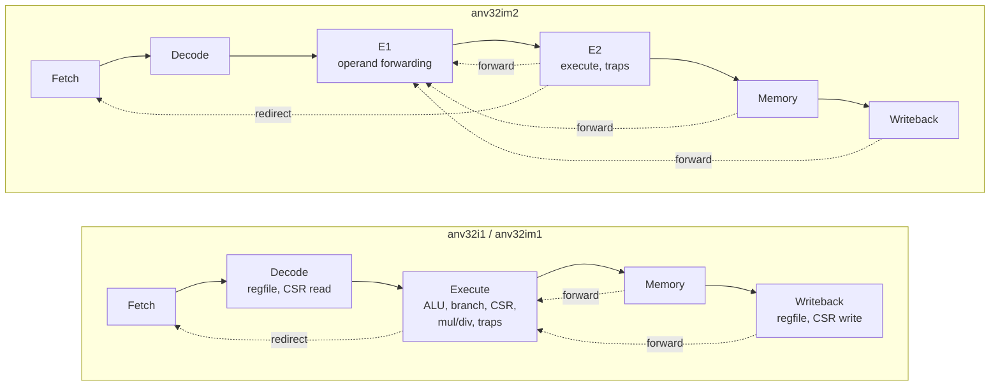
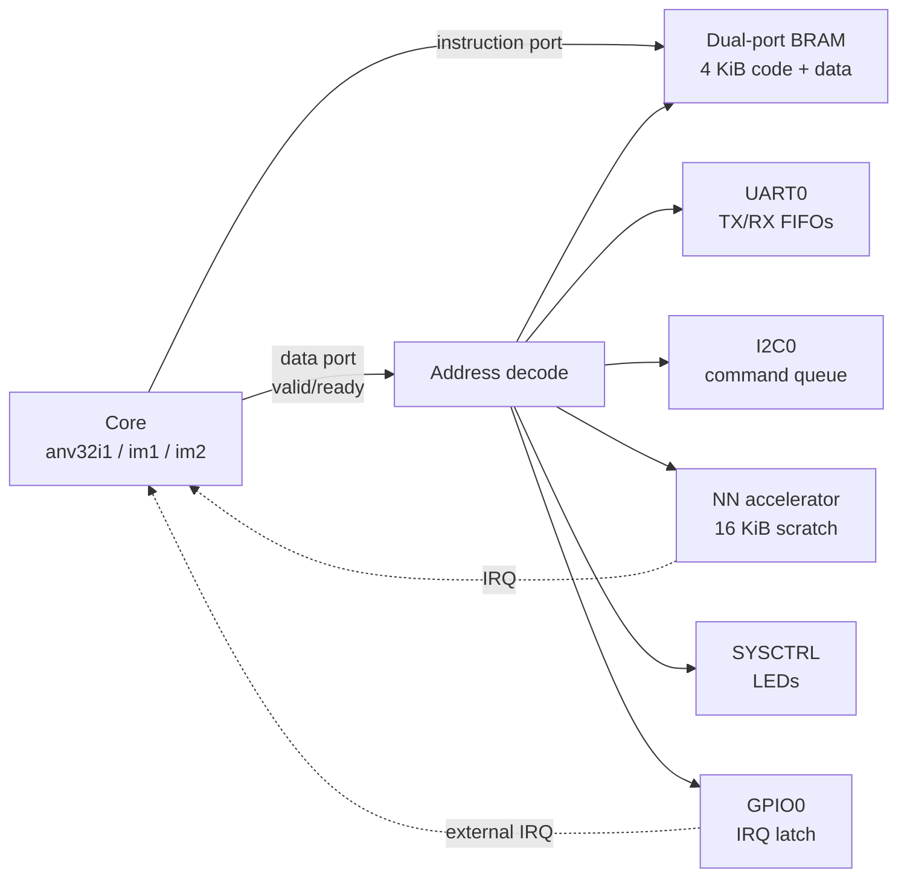

# anv32

[](https://github.com/sonmezarda/anv32/actions/workflows/ci.yml)

A family of RISC-V cores and a small SoC around them, written in
SystemVerilog. The idea is to build different kinds of cores and
implementations for different needs, and to compare them on the same SoC,
tests and benchmarks.

The main goal is learning: start with a simple RV32I pipeline, add features,
see what breaks timing, revise the microarchitecture and measure the
difference. The second goal is to end up with cores that are actually usable
at MCU level. It follows my earlier 8-bit fully custom CPU, ArniComp.

Today there are three in-order cores that share most of their pipeline, an SoC
with UART, I2C and a first int8 neural-network accelerator, and a
Verilator-based test and benchmark flow. Most development happens on a Tang
Nano 9K (Gowin GW1NR-9); the design has also been run on a PYNQ-Z2.

This is a work in progress. A superscalar core, a Linux-capable core, GPIO,
SPI, timers, a proper peripheral bus and more are planned; see
[Status](#status) and the [roadmap](docs/roadmap.md).

## Cores

| Core       | ISA                | Pipeline                         |
| ---------- | ------------------ | -------------------------------- |
| `anv32i1`  | RV32I + Zicsr      | 5-stage (F D E M W)              |
| `anv32im1` | RV32IM + Zicsr     | 5-stage, multi-cycle divider     |
| `anv32im2` | RV32IM + Zicsr     | 6-stage, execute split into E1/E2 |

The name is `anv32` + ISA letters + microarchitecture revision. All cores share
the decoder, CSR file, fetch/decode/memory/writeback stages and the hazard unit
(`rtl/core/common`, `rtl/core/pipe5`); each variant has its own execute stage
and top level.



Common features:

- Machine mode only, with the standard M-mode CSRs (`mstatus`, `misa`, `mie`,
  `mip`, `mtvec`, `mscratch`, `mepc`, `mcause`, `mtval`, the ID CSRs) and the
  `mcycle`/`minstret` counters with their `cycle`/`instret` aliases
- Precise traps for `ECALL`, `EBREAK`, illegal instructions (including bad CSR
  accesses) and misaligned loads, stores and jump targets; `MRET`; one
  external interrupt. Writes to `mstatus`/`mie` refetch the following
  instructions, so interrupt enable changes take effect at the next
  instruction.
- Operand forwarding from M and W; load-use hazards stall
- Separate instruction and data ports into a dual-port BRAM
- Single-cycle multiplier and a 32-cycle radix-2 divider (`im` cores)
- `mem_valid`/`mem_ready` handshake on the data port so the pipeline can wait
  on slow devices (`anv32im2`; the older cores ignore `mem_ready`)

`anv32i1` is frozen. It sits right at 27 MHz on the GW1NR-9 and is kept as the
simple reference core. New work goes into `anv32im2`, which the FPGA project
uses by default.

CPI on a few of the benchmark programs (`make bench`, `-Os`):

| Benchmark          | `anv32i1` | `anv32im1` | `anv32im2` |
| ------------------ | --------: | ---------: | ---------: |
| `c_crc32`          |     1.274 |      1.274 |      1.435 |
| `c_matrix_mul_4x4` |     1.390 |      1.155 |      1.296 |
| `c_fir_filter`     |     1.338 |      1.158 |      1.395 |
| `branch_taken`     |     2.316 |      2.316 |      2.974 |

On `anv32i1`, the matrix and FIR kernels run without `M` and call libgcc for
multiplication, so they retire many more instructions. See
[`docs/benchmarks.md`](docs/benchmarks.md).

## SoC

[`rtl/soc/anv32_soc_top.sv`](rtl/soc/anv32_soc_top.sv) picks the core with
`CORE_TYPE` (0 = i1, 1 = im1, 2 = im2). The wrappers `anv32{i1,im1,im2}_soc_top`
fix that parameter for the Gowin project.



- 4 KiB of on-chip BRAM for code and data, initialized from byte-lane hex files
- UART with programmable baud rate and 16-entry TX/RX FIFOs
- I2C master with a command queue, repeated START, clock stretching, timeout,
  arbitration-lost detection and bus recovery. Tested on hardware with a 16x2
  LCD backpack and a QMC5883L magnetometer.
- NN accelerator (first version): an int8 dense-layer engine built on a
  4-lane dot-product unit, with 16 KiB of scratch memory, argmax and a cycle
  counter
- GPIO interrupt input with a pending/clear register (the rest of GPIO is
  planned)
- Status LEDs

The address map is in [`docs/memory_map.md`](docs/memory_map.md). C headers
are in [`sw/include`](sw/include), and the matching SystemVerilog packages are
in [`rtl/include`](rtl/include).

### MNIST demo

The accelerator is a first experiment and will be extended; this demo is its
first end-to-end test.

[`sw/fpga/nn_accel_uart_mnist.c`](sw/fpga/nn_accel_uart_mnist.c) receives a
model and 28x28 images over UART, runs one 784 -> 10 dense layer on the
accelerator and sends back the scores, the predicted digit and the
accelerator cycle count. The model is a
nearest-centroid classifier built from the MNIST training set by
[`tools/generate_mnist_demo.py`](tools/generate_mnist_demo.py).

```sh
make fpga FILE=sw/fpga/nn_accel_uart_mnist.c   # then build and program in Gowin
pip install numpy pyserial
python3 tools/uart_mnist_client.py --port /dev/ttyUSB0 --load-model --show-image
```

The model only needs to be uploaded once. Later runs can drop `--load-model`
and pass `--index N` to pick a test image.

## Getting started

Requirements:

- `verilator` (5.x)
- `python3`
- `riscv64-unknown-elf-gcc`, `objcopy`, `objdump`
- `spike` (optional, for `make arch-test` and the commit-log diff tests)
- Gowin IDE (for the FPGA build)

```sh
make all          # stage-level unit tests
make core-tests   # self-checking core and SoC tests on all three cores
make riscv-tests  # official riscv-tests (rv32ui, rv32um, rv32mi)
make bench        # benchmarks on all three cores
make check        # all of the above
make arch-test    # official riscv-arch-test, compared against Spike
make cpu-run ASM=sw/examples/hazard_raw.S CYCLES=60   # pipeline trace
make asm-hard-test                                    # commit-log diff against Spike
```

[`docs/simulation.md`](docs/simulation.md) covers the simulation targets and
their options.

### FPGA

```sh
make fpga FILE=sw/fpga/uart_hello.c
```

This builds the program and writes `fpga/gowin/anv32/src/prog*.hex`. The BRAM
loads these files at synthesis. Open `fpga/gowin/anv32/anv32.gprj` in the Gowin
IDE, then synthesize and program. The project references RTL directly from
`rtl/`. Only the Gowin project is in the repo for now; the RTL itself is not
vendor specific.

## Layout

```text
rtl/core/        cores: common blocks, shared pipeline stages, per-core execute/top
rtl/peripherals/ uart, i2c, nn_accelerator
rtl/soc/         SoC top and per-core wrappers
rtl/include/     ISA, config and register-map packages
sim/tb/          Verilator testbenches
sw/              crt0, linker scripts, examples, FPGA programs, benchmarks, tests,
                 compliance-test model files
tools/           build, hex conversion, Spike diff, benchmark and MNIST scripts
fpga/gowin/      Gowin project
docs/            memory map, simulation, benchmarks, roadmap
```

## Status

Working today: the three cores, UART, I2C, the first NN accelerator and the
MNIST demo. All three cores pass riscv-tests and riscv-arch-test for the
extensions they implement (RV32I/RV32IM, Zicsr and the machine-mode
privileged suite); the only skipped tests need optional features listed under
the limitations below. Planned next:

- A superscalar core alongside the current in-order ones
- A Linux-capable core (S/U modes, MMU, atomics)
- A more capable NN accelerator
- GPIO, SPI, timer and PWM peripherals. Their addresses and register layouts
  are already defined, but most are not implemented yet; see
  [`docs/memory_map.md`](docs/memory_map.md#register-status).
- A shared peripheral bus with access faults on bad addresses
- Timer interrupt and vectored interrupts

Current limitations:

- Only machine mode; no U-mode, and zero PMP entries.
- Misaligned loads and stores trap instead of being handled in hardware.
- `FENCE` is a no-op; `FENCE.I` (Zifencei) is not supported.
- No debug module and no trigger CSRs (Sdtrig).
- No `time` CSR; `cycle` and `instret` are implemented.
- Peripherals are decoded directly in the SoC top.
- Accesses to unmapped addresses read as zero instead of trapping.

[`docs/roadmap.md`](docs/roadmap.md) has the full list.
