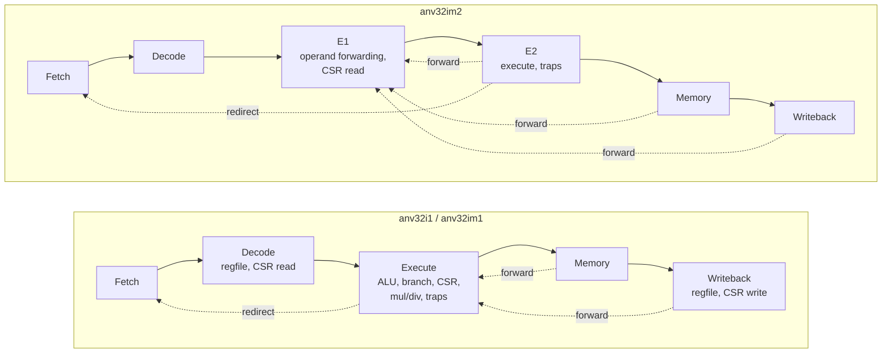
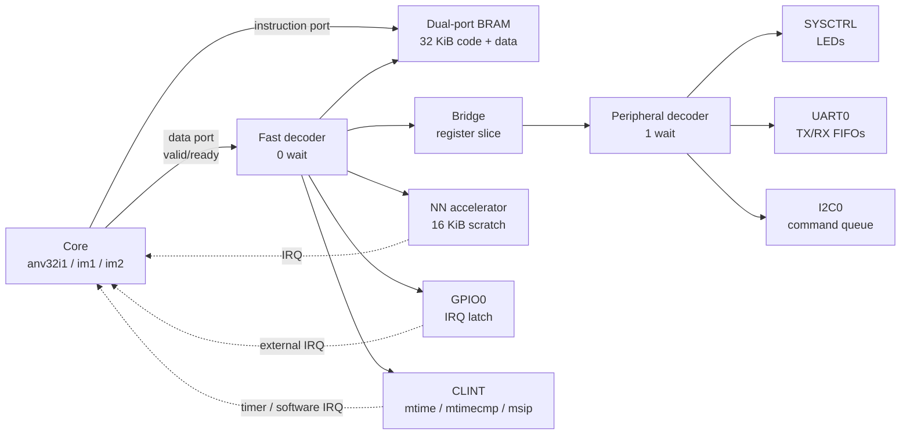

# anv32

[](https://github.com/sonmezarda/anv32/actions/workflows/ci.yml)

A family of RISC-V cores and a small SoC around them, written in
SystemVerilog. The idea is to build different kinds of cores and
implementations for different needs, and to compare them on the same SoC,
tests and benchmarks.

The main goal is learning: start with a simple RV32I pipeline, add features,
see what breaks timing, revise the microarchitecture and measure the
difference. The second goal is to end up with cores that are actually usable
at MCU level. It follows my earlier 8-bit fully custom CPU, ArniComp.

Today there are three in-order cores that share most of their pipeline, an SoC
with UART, I2C, a CLINT timer and a first int8 neural-network accelerator that
runs FreeRTOS, and a Verilator-based test and benchmark flow. Most development happens on a Tang
Nano 9K (Gowin GW1NR-9); the design has also been run on a PYNQ-Z2.

This is a work in progress. A superscalar core, a Linux-capable core, GPIO,
SPI, timers and more are planned; see
[Status](#status) and the [roadmap](docs/roadmap.md).

## Cores

| Core       | ISA                | Pipeline                         |
| ---------- | ------------------ | -------------------------------- |
| `anv32i1`  | RV32I + Zicsr      | 5-stage (F D E M W)              |
| `anv32im1` | RV32IM + Zicsr     | 5-stage, multi-cycle divider     |
| `anv32im2` | RV32IM + Zicsr     | 6-stage, execute split into E1/E2 |

The name is `anv32` + ISA letters + microarchitecture revision. All cores share
the decoder, CSR file, fetch/decode/memory/writeback stages and the hazard unit
(`rtl/core/common`, `rtl/core/pipe5`); each variant has its own execute stage
and top level.



Common features:

- Machine mode only, with the standard M-mode CSRs (`mstatus`, `misa`, `mie`,
  `mip`, `mtvec`, `mscratch`, `mepc`, `mcause`, `mtval`, the ID CSRs) and the
  `mcycle`/`minstret` counters with their `cycle`/`instret` aliases
- Precise traps for `ECALL`, `EBREAK`, illegal instructions (including bad CSR
  accesses) and misaligned loads, stores and jump targets; `MRET`; one
  external interrupt. Writes to `mstatus`/`mie` refetch the following
  instructions, so interrupt enable changes take effect at the next
  instruction.
- Operand forwarding from M and W; load-use hazards stall
- Separate instruction and data ports into a dual-port BRAM
- Single-cycle multiplier and a 32-cycle radix-2 divider (`im` cores)
- valid/ready handshake on both the instruction and the data port, so the
  pipeline can wait on slow memories and devices

`anv32i1` is frozen. It sits right at 27 MHz on the GW1NR-9 and is kept as the
simple reference core. New work goes into `anv32im2`, which the FPGA project
uses by default.

CPI on a few of the benchmark programs (`make bench`, `-Os`):

| Benchmark          | `anv32i1` | `anv32im1` | `anv32im2` |
| ------------------ | --------: | ---------: | ---------: |
| `c_crc32`          |     1.274 |      1.274 |      1.419 |
| `c_matrix_mul_4x4` |     1.390 |      1.155 |      1.232 |
| `c_fir_filter`     |     1.338 |      1.158 |      1.316 |
| `branch_taken`     |     2.316 |      2.316 |      2.974 |

On `anv32i1`, the matrix and FIR kernels run without `M` and call libgcc for
multiplication, so they retire many more instructions. See
[`docs/benchmarks.md`](docs/benchmarks.md).

Against other open-source cores, `make corebench` runs CoreMark and C
kernels on every core in the same testbench, and `make fpga-eval` measures
each core's own Fmax and utilization; see [`docs/corebench.md`](docs/corebench.md).

## SoC

[`rtl/soc/anv32_soc_top.sv`](rtl/soc/anv32_soc_top.sv) is the only SoC top,
and every build option is one of its parameters:

| Parameter | Default | Meaning |
|---|---|---|
| `CORE_TYPE` | `2` | 0 = i1, 1 = im1, 2 = im2 |
| `BRAM_ADDR_W` | `13` | Word address width of the code/data BRAM (13 = 32 KiB) |
| `CLK_FREQ` | `27_000_000` | Clock in Hz; sets UART baud and I2C SCL timing |
| `MTIME_FREQ` | `1_000_000` | CLINT `mtime` rate in Hz; must divide `CLK_FREQ` |
| `HAS_CLINT`, `HAS_GPIO`, `HAS_SYSCTRL`, `HAS_UART`, `HAS_I2C` | `1` | Include that peripheral |
| `HAS_NN` | `0` | Include the NN accelerator |
| `HAS_BOOTLOADER` | `1` | UART bootloader in the top `BOOT_SIZE` (1 KiB) of the BRAM; needs UART and SYSCTRL |
| `BOOT_BAUD` | `115_200` | Baud rate of the UART boot trigger |

The defaults are the FreeRTOS build for the Tang Nano 9K. The GW1NR-9 has 26
BSRAM blocks: 32 KiB of BRAM takes 16 and the register file 2, while the NN
accelerator alone needs 16, so it only fits next to a smaller BRAM (the
[MNIST demo](#mnist-demo) uses `HAS_NN = 1`, `BRAM_ADDR_W = 10`).
With the bootloader in the top 1 KiB, programs get the 31 KiB below it.

A disabled peripheral keeps its address range: it reads as zero and ignores
writes, like an unmapped address, so the memory map and software do not change
between builds. Its outputs go idle (UART TX high, I2C lines released, IRQ low).
`make soc-configs` checks that every core and peripheral combination still
elaborates.



- 32 KiB of on-chip BRAM for code and data, initialized from byte-lane hex
  files at synthesis, with a UART bootloader in the top 1 KiB
- UART with programmable baud rate and 16-entry TX/RX FIFOs
- I2C master with a command queue, repeated START, clock stretching, timeout,
  arbitration-lost detection and bus recovery. Tested on hardware with a 16x2
  LCD backpack and a QMC5883L magnetometer.
- NN accelerator (first version): an int8 dense-layer engine built on a
  4-lane dot-product unit, with 16 KiB of scratch memory, argmax and a cycle
  counter (optional, off by default)
- CLINT with a 64-bit `mtime` / `mtimecmp` machine timer and `msip` software
  interrupt in the standard SiFive/ACLINT layout (anv32im1 and anv32im2)
- GPIO interrupt input with a pending/clear register (the rest of GPIO is
  planned)
- Status LEDs
- A valid/ready data bus in two tiers: BRAM and GPIO answer with no wait
  states, the accelerator and CLINT reads are registered at the core boundary,
  and the slower peripherals sit behind a register slice.
  Peripheral registers have RP2040-style SET/CLR/XOR aliases for single-store
  bit updates.

The address map and the bus are described in
[`docs/memory_map.md`](docs/memory_map.md). C headers
are in [`sw/include`](sw/include), and the matching SystemVerilog packages are
in [`rtl/include`](rtl/include).

### FreeRTOS

FreeRTOS runs on `anv32im1` and `anv32im2` with the official RISC-V port,
unchanged: the tick comes from the CLINT and task switches use `ecall`. The
kernel is the `third_party/FreeRTOS-Kernel` submodule; the board files
(config, linker script, startup) are in [`sw/freertos`](sw/freertos).

[`sw/freertos/uart_demo.c`](sw/freertos/uart_demo.c) blinks LED0, prints the
uptime over UART once a second, and counts presses of button S1 through the
GPIO interrupt, which wakes a task from the interrupt handler.

```sh
make fpga FILE=sw/freertos/uart_demo.c   # default SoC parameters, then build and program in Gowin
```

```text
anv32 FreeRTOS V11.3.2
uptime 1 s, ticks 1000
uptime 2 s, ticks 2000
button 1
```

In simulation, `make core-tests TEST_SUITES=rtos` checks the tick, queues,
an interrupt waking a task, and that preemption keeps every register intact.

### MNIST demo

The accelerator is a first experiment and will be extended; this demo is its
first end-to-end test. It needs the accelerator in the build: set
`HAS_NN = 1` and `BRAM_ADDR_W = 10` in `anv32_soc_top`, and build the program
with `BOOT_ADDR=0xC00` (the top 1 KiB of the 4 KiB BRAM).

[`sw/fpga/nn_accel_uart_mnist.c`](sw/fpga/nn_accel_uart_mnist.c) receives a
model and 28x28 images over UART, runs one 784 -> 10 dense layer on the
accelerator and sends back the scores, the predicted digit and the
accelerator cycle count. The model is a
nearest-centroid classifier built from the MNIST training set by
[`tools/generate_mnist_demo.py`](tools/generate_mnist_demo.py).

```sh
make fpga FILE=sw/fpga/nn_accel_uart_mnist.c BOOT_ADDR=0xC00   # then build and program in Gowin
pip install numpy pyserial
python3 tools/uart_mnist_client.py --port /dev/ttyUSB0 --load-model --show-image
```

The model only needs to be uploaded once. Later runs can drop `--load-model`
and pass `--index N` to pick a test image.

## Getting started

Requirements:

- `verilator` (5.x)
- `python3` (`pyserial` for `make load` and the MNIST client)
- `riscv64-unknown-elf-gcc`, `objcopy`, `objdump`
- `spike` (optional, for `make arch-test` and the commit-log diff tests)
- Gowin IDE (for the FPGA build)

FreeRTOS, CoreMark and CV32E40P are submodules; fetch them once with
`git submodule update --init`.

```sh
make all          # stage-level unit tests
make core-tests   # self-checking core, SoC and FreeRTOS tests on all three cores
make boot-test    # UART bootloader end to end on all three cores
make riscv-tests  # official riscv-tests (rv32ui, rv32um, rv32mi)
make bench        # benchmarks on all three cores
make check        # all of the above
make corebench    # CoreMark and C kernels on anv32 and the reference cores
make arch-test    # official riscv-arch-test, compared against Spike
make cpu-run ASM=sw/examples/hazard_raw.S CYCLES=60   # pipeline trace
make asm-hard-test                                    # commit-log diff against Spike
```

[`docs/simulation.md`](docs/simulation.md) covers the simulation targets and
their options.

### FPGA

```sh
make fpga FILE=sw/fpga/uart_hello.c
```

This builds the program and writes `fpga/gowin/anv32/src/prog*.hex`, with the
UART bootloader merged in at the top of the BRAM. The BRAM loads these files
at synthesis. Sources under `sw/freertos/` are built with the FreeRTOS kernel
automatically. Open `fpga/gowin/anv32/anv32.gprj` in the Gowin IDE, then
synthesize and program. The project references RTL directly from `rtl/`. Only
the Gowin project is in the repo for now; the RTL itself is not vendor
specific.

Once a bitstream with the bootloader is on the board, new software goes over
UART instead, without the reset button or a new bitstream:

```sh
make load FILE=sw/freertos/uart_demo.c LOAD_PORT=/dev/ttyUSB0
python3 tools/uart_load.py --port COM5 build/fpga/c/uart_demo/uart_demo.bin --monitor   # Windows
```

`tools/uart_load.py` (needs `pyserial`) sends an 8-byte trigger that the SoC
watches for in hardware; it resets the SoC into the bootloader, which takes
the image with a CRC-32 check and runs it. A power-on or button reset runs the
program in the BRAM straight away. The protocol is described in
[`sw/boot/bootloader.S`](sw/boot/bootloader.S). The image only lives in the
BRAM, so it is gone after a power cycle; `make fpga` puts a program in the
bitstream.

When the Gowin IDE runs on Windows and opens the repository over WSL, it
rewrites the file paths in `anv32.gprj` as absolute `\\wsl$` paths on every
save. A git clean filter turns them back into relative paths on commit; it
has to be set up once per clone:

```sh
git config filter.gowinpath.clean "sed -E 's#path=\"[^\"]*/(rtl/[^\"]*)\"#path=\"../../../\\1\"#'"
```

## Layout

```text
rtl/core/        cores: common blocks, shared pipeline stages, per-core execute/top
rtl/peripherals/ clint, uart, i2c, gpio, sysctrl, nn_accelerator
rtl/soc/         SoC top, bus decoder/bridge/read pipe/register front end
rtl/include/     ISA, config and register-map packages
sim/tb/          Verilator testbenches
sim/corebench/   cross-core benchmark testbench, core registry and adapters
sw/              crt0, linker scripts, examples, FPGA programs, FreeRTOS port
                 files and demos, benchmarks, tests, compliance-test model files
tools/           build, hex conversion, Spike diff, benchmark and MNIST scripts
third_party/     FreeRTOS kernel, CoreMark, CV32E40P (submodules)
fpga/gowin/      Gowin project
fpga/eval/       core-only Fmax/utilization flow (Gowin, Vivado)
docs/            memory map, simulation, benchmarks, roadmap
```

## Status

Working today: the three cores, UART, I2C, the CLINT, the UART bootloader,
the first NN accelerator, the MNIST demo, and FreeRTOS on `anv32im1`/`anv32im2` (in
simulation and on the Tang Nano 9K). All three cores pass riscv-tests and riscv-arch-test for the
extensions they implement (RV32I/RV32IM, Zicsr and the machine-mode
privileged suite); the only skipped tests need optional features listed under
the limitations below. Planned next:

- A superscalar core alongside the current in-order ones
- A Linux-capable core (S/U modes, MMU, atomics)
- A more capable NN accelerator
- GPIO, SPI, timer and PWM peripherals. Their addresses and register layouts
  are already defined, but most are not implemented yet; see
  [`docs/memory_map.md`](docs/memory_map.md#register-status).
- Access faults on unmapped addresses
- Vectored interrupts, an interrupt controller and general-purpose timers

Current limitations:

- Only machine mode; no U-mode, and zero PMP entries.
- Misaligned loads and stores trap instead of being handled in hardware.
- `FENCE` is a no-op; `FENCE.I` (Zifencei) is not supported.
- No debug module and no trigger CSRs (Sdtrig).
- No `time` CSR; `cycle` and `instret` are implemented.
- Accesses to unmapped addresses read as zero instead of trapping.

[`docs/roadmap.md`](docs/roadmap.md) has the full list.
